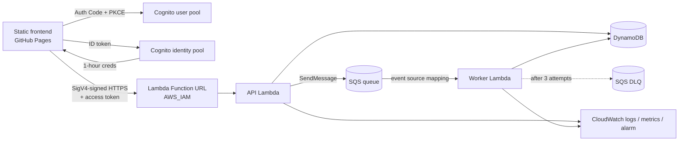

# TransitShield

**Synthetic Airport Cargo and Financial Anomaly Investigation Platform** — a
college cloud-computing project that demonstrates a secure, asynchronous,
serverless architecture on AWS with an explainable rule engine and a
professional investigation UI.

> **Synthetic data only.** Every airport, company, flight, shipment and
> financial reference is fictional and generated deterministically. The risk
> rules and thresholds are **illustrative** and have **not** been validated for
> any real-world customs, security or financial decision. A high score means a
> fictional record has data-quality or relationship inconsistencies; it is
> **not** evidence that anyone did anything wrong.

* **Live app:** https://bedyrune17.github.io/transitshield/ (local demo mode works for anyone; AWS mode requires an invited account)
* **Region:** `ap-south-1` · **Stack:** `transitshield`

---

## Contents
1. [Problem statement and objectives](#problem-statement-and-objectives)
2. [Features](#features)
3. [Architecture](#architecture)
4. [AWS services and their roles](#aws-services-and-their-roles)
5. [Data flow](#data-flow)
6. [Risk-scoring methodology](#risk-scoring-methodology)
7. [Data model](#data-model)
8. [Authentication and authorisation](#authentication-and-authorisation)
9. [Cost-control assumptions](#cost-control-assumptions)
10. [Run locally](#run-locally)
11. [Configuration](#configuration)
12. [Testing](#testing)
13. [Deployment](#deployment)
14. [Known limitations](#known-limitations)
15. [Cleanup](#cleanup)
16. [Screenshots](#screenshots)
17. [Repository layout](#repository-layout)

Supporting documents: [Architecture](docs/ARCHITECTURE.md) ·
[AWS services](docs/AWS_SERVICES.md) · [Cost safety](docs/COST_SAFETY.md) ·
[Testing](docs/TESTING.md) · [Deployment](docs/DEPLOYMENT.md) ·
[Viva guide](docs/VIVA_GUIDE.md)

---

## Problem statement and objectives

Investigators reviewing cargo and trade documentation must reconcile many
linked documents — manifests, air waybills, invoices and payments — and
explain *why* a record deserves attention. Doing this synchronously, without
an audit trail or with opaque scoring, does not scale and is hard to defend.

TransitShield shows how a small, cost-free serverless system can:

1. generate a reproducible synthetic dataset with **known, planted** anomalies;
2. process records **asynchronously** through a queue with retries,
   dead-lettering and recovery;
3. score each record with **transparent, configurable** rules and a
   human-readable explanation of every point;
4. support a case workflow with **server-validated identity**, optimistic
   locking and an append-only audit trail;
5. **evaluate** the rules honestly against the planted ground truth; and
6. stay within **verified zero-cost** limits for the target account.

## Features

| # | Feature | Where |
|---|---|---|
| 1 | Investigation dashboard: totals, processed, pending jobs, flagged, high-priority / awaiting-review / resolved / dismissed cases, failures, success rate, risk distribution chart, activity timeline, live AWS queue/DLQ/alarm/Lambda metrics | Overview |
| 2 | Deterministic synthetic generator: fixed seed, 8 labelled scenarios, ~20–300 records, planted patterns listed per dataset | Settings → Generate |
| 3 | Explainable rule engine (11 rules, 3 profiles), score 0–100, level, applied rules, explanations, evidence fields, dataset/job/version stamps | Record drawer |
| 4 | Record explorer: search, filters (risk, processing status, investigation status, type, date range, rule, entity), sorting, pagination, detail drawer with source fields, evidence highlighting, history and links | Records |
| 5 | Case management: New → Under review → Escalated → Dismissed/Resolved (+ reopen), comments, required reasons, full history, optimistic locking | Investigations |
| 6 | Relationship explorer: interactive SVG graph, focus/depth, follow connections, flagged highlighting, "why connected" with the exact field or rule evidence | Relationship Explorer |
| 7 | Asynchronous queue: 202 Accepted vs completed, job table (ID, type, submitted, status, durations, attempts, failure reason), auto-refresh | Processing Queue |
| 8 | Controlled failure recovery: transient (fails twice then succeeds) / permanent (dead-letter) demo flag, backoff retries, DLQ, alarm, Recover action | Processing Queue |
| 9 | Append-only audit history of generation, jobs, scoring, cases, comments, auth failures, resets | Audit History |
| 10 | Evaluation vs planted labels: TP/FP/TN/FN, precision, recall, FPR, F1, per-pattern recall, profile comparison | Risk Evaluation |
| — | Local demo mode (no AWS) and AWS mode behind one data-access interface; explicit mode indicator; no silent fallback | Settings |

## Architecture



Full explanation (why async, what SQS adds, why a separate worker, how
idempotency and access control work, how failures are observed and
recovered): **[docs/ARCHITECTURE.md](docs/ARCHITECTURE.md)**.

## AWS services and their roles

| Service | Role in TransitShield |
|---|---|
| **AWS Lambda** | `transitshield-api` (HTTP API behind a Function URL: auth, validation, authorisation, reads/writes) and `transitshield-worker` (SQS consumer: scoring, persistence, auto-cases, retries/dead-lettering). Python 3.13, arm64. |
| **Amazon SQS** | `transitshield-jobs` buffers scoring jobs (visibility 180 s, long polling); `transitshield-dlq` holds jobs that exhausted retries (redrive backstop `maxReceiveCount` 5). |
| **Amazon DynamoDB** | Four provisioned tables: records (+ dataset metadata and separated labels), jobs (TTL), cases, audit. Conditional writes give idempotency and optimistic locking. |
| **Amazon Cognito** | User pool (Lite tier, admin-invite only, hosted UI, groups `analysts` / `admins`) and identity pool (temporary credentials that can only invoke the API URL). |
| **Amazon CloudWatch** | Structured JSON logs (3-day retention), EMF custom metrics, DLQ alarm; read live by the dashboard. |
| AWS IAM / CloudFormation | Least-privilege roles; the whole stack is one template (`infrastructure/template.yaml`). |

Details and configuration: [docs/AWS_SERVICES.md](docs/AWS_SERVICES.md).

## Data flow

1. Analyst generates a dataset (`POST /datasets`) → records, separate labels
   and metadata are written; `DATASET_GENERATED` audited.
2. Analyst submits a job (`POST /jobs`) → job `QUEUED`, message sent to SQS,
   **202 Accepted** returned; `JOB_SUBMITTED` audited.
3. SQS triggers the worker → lease acquired (`PROCESSING`) → all records of
   the dataset loaded for context → selected records scored → results saved →
   HIGH records get cases → `SCORING_COMPLETED` audited → job `SUCCEEDED`.
4. On error: `RETRY_SCHEDULED` with backoff (5/15/30 s) → after 3 attempts
   `DEAD_LETTERED` and copied to the DLQ (alarm fires) → analyst **Recover** →
   `REDRIVEN` → processed again.
5. UI polls jobs/records until terminal; dashboard, evaluation and graph read
   the stored results.

## Risk-scoring methodology

Rules live in [`backend/shared/risk_rules.json`](backend/shared/risk_rules.json)
(ruleset `2026.10-demo.1`). A record's score is the **sum of the weights of the
rules that fired** (each rule at most once), **capped at 100**. Every fired
rule contributes human-readable explanations and evidence fields.

| Rule | What it checks (generic data-quality / relationship test) | Weight |
|---|---|---|
| R01 | Required field missing or empty | 35 |
| R02 | Document reference also appears on another record of the same type | 40 |
| R03 | Invoice vs shipment declared value (tolerance 5 %) or transaction vs invoice (2 %) differ | 35 |
| R04 | Currency differs from the linked document | 20 |
| R05 | Arrival not after departure; payment > 30 days before invoice | 30 |
| R06 | Seller/buyer or payee/payer differ from the linked document | 30 |
| R07 | Same invoice claimed by more than one shipment/transaction | 30 |
| R08 | Linked record missing or not linking back | 30 |
| R09 | Consignee appears on ≥ 6 shipments in the dataset | 20 |
| R10 | Malformed / out-of-range value (non-positive amount, unknown currency or airport, bad timestamp, origin = destination) | 30 |
| R11 | Three or more independent rules fired | 15 |

**Levels (balanced profile, illustrative):** NONE 0 · LOW 1–29 · MEDIUM 30–59 ·
HIGH ≥ 60. Records with score ≥ 30 are *flagged*; HIGH records open a case
automatically. `strict` and `lenient` profiles change tolerances and
thresholds so their precision/recall trade-off can be compared on the same
data. Outputs are reproducible: identical records + rule version → identical
output (`scoringVersion = engine-1.0.0/rules-2026.10-demo.1/<profile>`).

Ground-truth labels are generated alongside the data but stored separately
(`#LABELS` item) and are **never** passed to the scoring engine. The same
engine runs in the Python worker and the browser; a parity test proves they
are byte-identical.

Example evaluation (scenario *mixed*, seed 42, 98 records, 22 planted):
balanced P = 1.00, R = 0.91; strict P = 0.96, R = 1.00; lenient P = 1.00,
R = 0.50. These numbers describe recovery of **our own planted patterns** only.

## Data model

See [docs/ARCHITECTURE.md § Data model](docs/ARCHITECTURE.md#data-model-and-access-patterns)
for keys, items and access patterns. Required attributes are present:
records (`recordId, recordType, source, createdAt, datasetId, processingStatus,
riskScore, riskLevel, triggeredRules, scoringVersion, linkedEntityIds,
version`), jobs (`jobId, recordIds, jobStatus, createdAt, updatedAt,
attemptCount, errorCode, errorSummary`), cases (`caseId, recordId,
caseStatus, assignedActor, createdAt, updatedAt, resolutionReason, version`),
audit (`eventId, caseId, recordId, actorId, action, timestamp, metadata`).

## Authentication and authorisation

* **Authentication:** Cognito hosted UI, Authorization Code + PKCE; public
  client without a secret; self sign-up disabled.
* **Transport gate:** Function URL `AuthType=AWS_IAM` — only SigV4 requests
  signed with the identity pool's credentials for signed-in users reach the
  function. Unsigned requests get **403 from AWS** (verified live).
* **Token verification:** the API verifies the Cognito access token's RS256
  signature (JWKS), `iss`, `exp`, `iat`, `token_use` and `client_id`.
* **Authorisation:** viewer (any signed-in user, read-only) / analyst
  (`analysts`) / admin (`admins`), enforced server-side on every write.
* **Input hardening:** method allow-list, 8 KB body limit, unknown-field
  rejection, strict ID patterns, per-user and global rate limits, safe error
  bodies with a request ID, structured logs without tokens or records.
* **CORS** is limited to the real origins and is **not** relied on for access
  control.

## Cost-control assumptions

The target account is on the **AWS Free plan** (verified 2026-10-16), which
does not charge out of pocket. Every service used fits an **Always Free**
allowance at demo scale; DynamoDB uses fixed provisioned capacity (21/25 RCU
and WCU). The full, dated classification, safeguards and residual risks are
in **[docs/COST_SAFETY.md](docs/COST_SAFETY.md)**.

## Run locally

Requirements: Python ≥ 3.11 and a modern browser (Node ≥ 20 only for the JS tests).

```bash
git clone https://github.com/bedyrune17/transitshield.git
cd transitshield
python scripts/serve_frontend.py
```

Open http://localhost:5173/ → **Settings → Generate** → **Records → Process
entire dataset**. Local demo mode needs no AWS account; data stays in your
browser.

## Configuration

| File | Purpose |
|---|---|
| `backend/shared/risk_rules.json` | Rules, weights, thresholds, profiles (single source of truth). Run `python scripts/sync_rules.py` after editing. |
| `frontend/js/config.js` | **Public** identifiers written by the deploy script (region, pool IDs, app client ID, domain, API URL). Empty ⇒ local mode only. |
| `.env.example` | Optional `TS_EXPECTED_ACCOUNT` for the scripts. No secrets anywhere. |

## Testing

```bash
python -m unittest discover -s tests/unit -t . -v   # 76 Python tests incl. Python/JS parity
node --test tests/js/frontend.test.mjs              # 6 JS tests incl. AWS SigV4 test vector
# against the deployed stack (opt-in, uses your AWS CLI credentials in memory):
TS_INTEGRATION=1 python -m unittest tests.integration.test_live_api -v
```

What is covered and the latest results: [docs/TESTING.md](docs/TESTING.md).

## Deployment

```bash
aws login --region ap-south-1                         # short-lived credentials, no access keys
python scripts/cost_check.py                          # read-only eligibility gate
python scripts/deploy.py deploy --account <12-digit-id>
python scripts/deploy.py create-user --account <id> --email you@example.edu --groups analysts
git push                                              # GitHub Actions tests + publishes Pages
```

Step-by-step procedure and the resource inventory: [docs/DEPLOYMENT.md](docs/DEPLOYMENT.md).

## Known limitations

* Synthetic, rule-based demo; not validated for operational use.
* Scans (jobs, cases, global audit view) are fine at the capped demo scale but
  would need GSIs and pagination for production.
* Local demo mode is single-tab (state in one browser's storage).
* The audit log is append-only by design but **not** cryptographically
  tamper-evident.
* Tokens are kept in `sessionStorage`; an XSS bug would expose them (mitigated
  by a strict CSP and text-only rendering).
* Deployment used the root user's short-lived console session.

## Cleanup

```bash
python scripts/cleanup.py --account <12-digit-id>        # dry run: lists exactly what will be deleted
python scripts/cleanup.py --account <12-digit-id> --yes  # deletes only the tagged 'transitshield' stack
```

This removes every TransitShield AWS resource (tables, queues, functions,
roles, user/identity pools, log groups, alarm) and nothing else. The GitHub
repository is not touched.

## Screenshots

Capture genuine screenshots from the running app (local or live):
Overview after processing; Records with filters; a record drawer showing the
score breakdown; Relationship Explorer with a dashed rule-evidence edge;
Processing Queue showing a dead-lettered job and the DLQ alarm, then recovery;
Risk Evaluation profile comparison; a resolved case with its history.

## Repository layout

```
backend/   api/ (API Lambda) · worker/ (worker Lambda) · shared/ (generator, scoring, rules, store, service, auth)
frontend/  index.html · css/ · js/ (core engine port, data providers, auth, UI, views) · data/risk_rules.json
infrastructure/template.yaml   CloudFormation (all resources, tagged)
scripts/   deploy · cost_check · inventory · cleanup · serve_frontend · sync_rules
tests/     unit/ (Python) · js/ (Node) · integration/ (live AWS, opt-in)
docs/      architecture · AWS services · cost safety · testing · deployment · viva guide
```

License: MIT.
