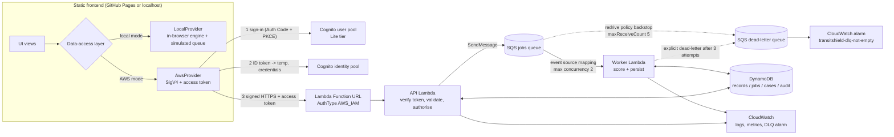

# TransitShield architecture

TransitShield is a serverless, event-driven application. A static browser
frontend talks to an authenticated API; scoring work is queued and done by a
separate worker; all state lives in DynamoDB; CloudWatch records logs,
metrics and an alarm. Everything runs on synthetic data.

## Request path (AWS mode)

1. **Sign-in.** The browser redirects to the Cognito hosted UI using the
   Authorization Code grant with PKCE (S256). The app client is public and
   has **no client secret**. Self sign-up is disabled; an administrator
   invites users.
2. **Temporary AWS credentials.** The ID token is exchanged with the Cognito
   identity pool (enhanced flow, unauthenticated identities disabled) for
   one-hour credentials of the `transitshield-signed-in-user-role`. That role
   can do exactly one thing: `lambda:InvokeFunctionUrl` on the API function.
3. **Signed call.** Every request is SigV4-signed in the browser (WebCrypto,
   verified against AWS's published test vector). The Function URL uses
   `AuthType=AWS_IAM`, so **AWS rejects unsigned or wrongly signed requests
   before the function runs**. Anonymous internet traffic therefore cannot
   invoke the API or generate Lambda/DynamoDB usage.
4. **Token verification in the function.** The request also carries the
   Cognito *access token* (`X-TransitShield-Token`). The API verifies its
   RS256 signature against the pool's JWKS and checks `iss`, `exp`, `iat`,
   `token_use == "access"` and `client_id`. The actor ID and groups come
   **only** from this verified token, never from the request body.
5. **Authorisation.** Groups map to roles: any signed-in user is a *viewer*
   (read-only); `analysts` can generate data, submit jobs and work cases;
   `admins` can additionally reset demo datasets. Every write checks the
   role server-side.
6. **Validation & limits.** Only `GET`, `POST` and `DELETE` are routed; bodies
   over 8 KB return 413; unknown fields are rejected; IDs must match strict
   patterns; per-user and global rate limits are enforced with atomic
   DynamoDB counters (TTL-expired).

CORS is configured for the real frontend origins only, but **CORS is not
access control**; it only tells browsers which origins may read responses.

## Why asynchronous processing

Scoring a dataset means reading every record (duplicate and relationship
rules need dataset-wide context), computing ~11 rules per record and writing
each result. Doing that inside the HTTP request would:

* tie the user's request to the slowest part of the system;
* fail outright on transient errors (throttling, timeouts) with no retry;
* let a burst of submissions overload the database.

Instead the API validates the request, writes a job item (`QUEUED`), sends a
small message (`{"jobId": ..., "datasetId": ...}`) to SQS and returns
**HTTP 202 Accepted** immediately. The UI shows *accepted is not completed*:
records display `Queued → Processing → Processed` and the queue page polls
the job until it reaches a terminal state.

### What SQS adds

* **Buffering:** submissions are absorbed by the queue; the worker drains it
  at a controlled rate (event-source `MaximumConcurrency = 2`, which also
  protects the account's low concurrency limit of 10).
* **Retries:** a failed message becomes visible again; the worker shortens
  its visibility to a backoff (5 s, 15 s, 30 s) and reports only that message
  in `batchItemFailures`, so other messages in the batch are not reprocessed.
* **Dead-lettering:** after 3 attempts the worker marks the job
  `DEAD_LETTERED`, copies the message to the DLQ and acknowledges it. The
  queue's own redrive policy (`maxReceiveCount = 5`) is a backstop for
  failures where the worker code never runs (timeouts, crashes).
* **Decoupling:** the API and worker scale, fail and are permissioned
  independently.

### Why a separate worker function

* **Least privilege:** the worker cannot delete data and cannot send to the
  main queue; the API cannot consume the main queue.
* **Fault isolation:** a scoring bug or a controlled failure does not affect
  API latency or availability.
* **Different limits:** API timeout 10 s, worker 30 s; the queue visibility
  timeout (180 s) is 6x the worker timeout as AWS recommends.

## Idempotency (why retries do not create duplicates)

SQS standard queues deliver **at least once**, and retries re-run work by
design. Every side effect is therefore idempotent:

| Side effect | Mechanism |
|---|---|
| Job start | Conditional update: allowed only from `QUEUED / RETRY_SCHEDULED / REDRIVEN`, or `PROCESSING` whose 60 s lease expired. A concurrent duplicate gets `LEASE_HELD_ELSEWHERE` and is acknowledged. |
| Job completion | Conditional on `jobStatus = PROCESSING` **and** `attemptCount` equal to the attempt that holds the lease. |
| Duplicate after success | A message for a `SUCCEEDED`/`FAILED` job is acknowledged and ignored (`DUPLICATE_IGNORED`). |
| Record result | Deterministic output for identical inputs + rule version; the processing-history entry is appended only if `lastJobId` differs (condition expression). |
| Case creation | Case ID is deterministic (`CASE-<datasetId>-<recordId>`); `attribute_not_exists(caseId)` makes the second creation a no-op. |
| Audit events | Event ID = SHA-256 of an idempotency key (e.g. `scoring-completed:<jobId>`, `case-status:<caseId>:v<version>`); `attribute_not_exists(eventId)` rejects duplicates. |
| Dataset seeding | Dataset ID is deterministic from scenario/seed/count; the metadata item is written with a condition, so re-seeding returns the existing dataset. |

`tests/unit/test_service.py::test_duplicate_delivery_creates_no_duplicates`
re-delivers a completed job and forces it to run again, then asserts the
case count, audit count and processing histories are unchanged.

## Concurrency control for cases

Each case item has a `version`. Status changes and comments send
`expectedVersion`; the write is `ConditionExpression: version = :expected`
and increments the version. A stale write gets **409 VERSION_CONFLICT** with
the current version; the UI keeps the analyst's typed text and offers a
reload. Cases are never hard-deleted by the application; a demo reset
archives them (read-only) and keeps their audit trail.

## Failure observation and recovery

| Where | What you see |
|---|---|
| Job item | `attemptCount`, per-attempt `{startedAt, endedAt, receiveCount, outcome, errorCode}`, `errorCode`, `errorSummary` |
| Audit trail | `JOB_ATTEMPT_FAILED`, `JOB_DEAD_LETTERED`, `JOB_FAILED`, `JOB_RECOVERY_REQUESTED`, `SCORING_COMPLETED` |
| CloudWatch Logs | Structured JSON lines (`requestId`, route, status, latency, `jobId`, `errorCode`) - never tokens or full records. Retention 3 days. |
| CloudWatch metrics | Embedded Metric Format: `JobsSucceeded`, `JobAttemptsFailed`, `JobsDeadLettered`, `RecordsScored`, `ProcessingMs` (namespace `TransitShield`); AWS/Lambda and AWS/SQS metrics. |
| CloudWatch alarm | `transitshield-dlq-not-empty` (DLQ visible messages > 0). Its state is read live by the API and shown in the dashboard. |
| Dashboard | Live SQS depth (waiting / in flight), DLQ depth, alarm state and worker Lambda invocations/errors/duration for the last hour, tagged **Live AWS**. |

**Controlled failure demo.** A job can be submitted with
`failureMode = transient` (attempts 1-2 raise an error, attempt 3 succeeds) or
`permanent` (every attempt fails → dead-lettered). The flag lives on that job
only; nothing touches infrastructure. **Recover** (analyst) clears the flag,
records the operator action, removes that job's message from the DLQ and
re-queues it. The retry budget restarts per recovery cycle (`attemptBase`).

## Data model and access patterns

DynamoDB, provisioned capacity, four tables (21 RCU / 21 WCU total):

| Table | Key | Items | Access patterns |
|---|---|---|---|
| `transitshield-records` (8/8) | PK `datasetId`, SK `recordId` | synthetic records + latest result; `#LABELS` item per dataset (ground truth, kept apart from scoring input); dataset metadata under PK `#DATASETS` | list a dataset's records (Query, `recordId > "#~"` skips special items); get one record (GetItem); list datasets (Query `#DATASETS`) |
| `transitshield-jobs` (4/4) | PK `jobId` | jobs (TTL 7 days) and `RATE#...` counters (TTL) | get job (consistent GetItem); list jobs (Scan, filter `itemType = JOB`) |
| `transitshield-cases` (4/4) | PK `caseId` | cases | get case; list cases (Scan) |
| `transitshield-audit` (5/5) | PK `streamId`, SK `eventId` | append-only events; streams `CASE#`, `JOB#`, `DATASET#`, `SECURITY#<day>` | case history (Query `CASE#<id>`); recent activity (Scan, sorted by `sortKey`) |

Record items store: `recordId, recordType, source, createdAt, datasetId,
groupId, fields, linkedEntityIds, processingStatus, riskScore, riskLevel,
flagged, triggeredRules, findings[{ruleId, weight, explanations, evidence}],
scoringVersion, scoringProfile, processedAt, lastJobId, processingHistory,
version`.

**Trade-offs.** Scans are used for jobs, cases and the global audit view
because the demo is capped (≤ 8 datasets × ≤ 300 records; jobs expire after 7
days). A production system would add GSIs (for example cases by status,
audit by day) and paginate, at the cost of extra provisioned capacity per
index. Four simple tables were chosen over single-table design for
readability; the capacity budget still fits the always-free allowance.
`processingStatus` for queued records is *derived* from active jobs rather
than written to every record on submit, halving write usage.

## Scoring engine

`backend/shared/scoring.py` (Python worker) and `frontend/js/core/scoring.js`
(browser) implement the same deterministic rules from
`backend/shared/risk_rules.json`. `tests/unit/test_parity.py` runs both on 14
scenario/seed/size combinations × 3 profiles and requires byte-identical
datasets, scores, explanations and evaluation metrics. See the README for
the rule list and thresholds.
